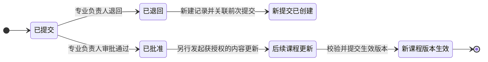

# 技术实施方案

## 1. 审查结论与架构决策

| 文档信息 | 内容 |
|---|---|
| 项目 | 南京工业职业技术大学产业数据库与人才需求预测系统 |
| 日期与状态 | 2026-11-27，技术实施方案，数据库设计已同步、待评审，含校方待确认事项 |
| 需求与数据基线 | [spec.md](./spec.md)、db-design.md（项目内部文档） |
| 治理依据 | [constitution.md](../constitution.md)、[AGENTS.md](../AGENTS.md) |
| 技术方案依据 | 技术实施方案 Prompt 3.1、AI实战项目需求 (1).docx |

### Spec 审查结果

| 状态 | 事项 | 对方案和后续阶段的影响 |
|---|---|---|
| 已明确 | 三个首期场景及 REQ-01～REQ-11、AC-01～AC-11。数据可追溯、三员分立、关键操作双人复核、年度交付数量要求均有文档依据。 | 按三个场景共享的数据能力设计，验收逐项追溯。 |
| 已明确 | 首期数据建设和业务验收面向江苏、浙江、上海、安徽的软件和信息技术服务业。 | 接入与业务查询使用同一地区及行业范围，按可核对证据执行。 |
| 已确认 | Java 17、Spring Boot 3.x、五个后端部署单元、本系统账号登录。数据库采用 MySQL 8.0 和四个逻辑库。 | 固定本方案服务和数据归属。框架小版本、校方环境和生产支持待核定。 |
| 实施前评审 | 账号凭据、持久会话及服务间身份校验按第 2 节执行。用户库结构已同步数据库设计。 | 登录开发前完成数据库设计评审，并确认校方签名和服务证书、会话时长及凭据初设授权。 |
| 实施前评审 | 批次和预测的受理、认领与恢复，以及跨服务审计与课程提交幂等已同步数据库设计。 | 评审结构与历史兼容条件，再开展涉及写入的实现。 |
| 规则缺口 | 安全管理员授权、关键操作清单、角色数据范围以及课程审批细则由校方确认。 | 可确定后端授权、复核和状态边界。资格规则和关键操作范围在对应功能实施及校方验收前冻结。 |
| 外部条件 | 已核对的 CnOpenData 样本可用于字段、导入与技能抽取验证。带日期的记录分散，真实预测验收需确认目标范围内的历史覆盖、评估方法和预警规则。 | 预测功能记录真实输入和配置版本。数据不足时返回业务失败。AC-05 通过需满足确认后的数据与评估条件。 |
| 验收缺口 | 每年不少于 4 项的计数单位、软件工程环节清单及性能指标由校方确认。 | 先实现数据与操作路径。对应年度、资源覆盖及量化性能验收按校方口径执行。 |

### 合宪性与关键决策

以 spec 中的行为、规则和验收为业务依据。服务归属和事务设计沿用已确认的数据库设计。关键规则集中在领域或应用层，验收测试从 AC 派生。若实现必须偏离权威文档，按治理规则先提出影响和待裁决项，经授权更新文档后再恢复实现。

| 决策 | 采用方案与取舍 | 来源 |
|---|---|---|
| D-01 服务部署 | 采用原架构图的网关、用户、AI、数据、课程五个独立后端单元。单后端模块化部署运维更轻，五单元保留已确认的服务职责与数据库归属，并增加服务联调和故障定位工作。 | 原始架构图、用户确认、db-design |
| D-02 版本及构建 | Java 17，Spring Boot 3.x。候选兼容线为 Boot 3.5.x、Spring Cloud 2025.0.x、Alibaba 2025.0.x。采用 Maven BOM 与同一版本矩阵，锁定补丁版本前验证启动、依赖树、数据库驱动、服务发现和消息联通。 | 用户确认、Prompt、官方兼容表 |
| D-03 所有权与一致性 | 库内使用 InnoDB 事务、唯一约束和外键。业务服务通过归属方校验跨库业务 ID。共享库直接联表可以缩短部分读取路径，但会耦合各服务数据模式。 | db-design、REQ-02、REQ-08、REQ-11 |
| D-04 登录与权限 | 用户服务保管 Argon2id 凭据摘要和可撤销的会话，签发 JWT。网关校验令牌，业务服务通过用户服务核对当前会话和数据权限。 | 用户确认、原始架构图、REQ-11、AC-11 |
| D-05 异步与失败语义 | 批次与预测分别使用归属表持久化受理和执行权，RocketMQ 传递任务标识，数据服务可从持久状态重新派发。单条技能操作维持限时请求。 | REQ-01、REQ-04、REQ-05、constitution |
| D-06 工程目录 | 工程根采用当前项目根，后端保留五个可独立部署的 Maven 模块，Vue 工程及测试单独组织。 | D-01、D-02、当前项目布局 |
| D-07 跨服务审计 | 业务变更和待投递审计事件同库提交，用户服务按稳定事件标识去重并回执。 | REQ-02、REQ-08、REQ-11、AC-11 |
| D-08 首次及重复提交 | 采集批次、预测运行和课程建议提交使用请求幂等键。课程退回后的重提继续关联前次提交，课程审批和版本生效各自独立。 | REQ-01、REQ-05、REQ-08、AC-08 |

### 技术版本与适配约束

- 后端业务服务采用 Spring MVC、Spring DI、MyBatis、Jackson、SLF4J 和 Logback。MapStruct 用于稳定且重复的 DTO 映射，复杂业务转换显式表达。外部同步 HTTP 调用优先采用配置了超时的 RestTemplate。Gateway Server Web MVC 是网关的候选实现，随 BOM 验证。
- 前端采用 Vue 3、TypeScript、Vite、Vue Router、Pinia。构建所需 Node.js 和包管理器版本在项目初始化前按所锁定的 Vite 官方要求校验。
- 原始资料中的 Nacos 用于服务发现，RocketMQ 用于持久任务通知。组件版本和校方现有服务由实施前检查确定。Redis 按兼容性和实际性能需要决定接入时机，核心业务规则和授权状态以其归属服务为准。
- Spring Boot 3.5.x 已结束开源支持。已选 3.x 作为方案基线，生产发布前确认可持续获得的补丁、安全修复责任和依赖联调证据。若必须改变主版本，先完成变更裁决。

[Spring Boot 3.5 系统要求](https://docs.spring.io/spring-boot/3.5/system-requirements.html) · [Spring Cloud Alibaba 版本矩阵](https://sca.aliyun.com/en/docs/2025.x/overview/version-explain/) · [Spring Boot 3.5 维护状态](https://github.com/spring-projects/spring-boot/milestone/346) · [MyBatis Starter 兼容表](https://mybatis.org/spring-boot-starter/mybatis-spring-boot-autoconfigure/index.html) · [Gateway Server Web MVC](https://docs.spring.io/spring-cloud-gateway/reference/4.3/spring-cloud-gateway-server-webmvc/starter.html)

### 工程根目录与模块布局

**工程根目录为当前项目根**。克隆后的 checkout 顶层沿用同一布局，构建配置与任务路径使用相对路径。治理文档和已有设计文档按其项目发布位置引用。

| 用途 | 根目录相对位置 | 约束 |
|---|---|---|
| Maven 聚合构建 | `backend/pom.xml` | 管理五个部署单元的 BOM 与共用构建设置。 |
| 网关 | `backend/gateway-service/pom.xml` | 负责入口路由与 JWT 校验。 |
| 用户和权限 | `backend/user-service/pom.xml` | 归属 user_db。 |
| 模型适配 | `backend/ai-service/pom.xml` | 归属 ai_db。 |
| 产业数据 | `backend/data-service/pom.xml` | 归属 data_db。 |
| 教学业务 | `backend/curriculum-service/pom.xml` | 归属 curriculum_db。 |
| Vue 工程 | `frontend/package.json`、`frontend/src/` | `frontend/src/api/` 为 API Client 和 Service，`frontend/src/api/types/` 为前端共享契约类型，`frontend/src/stores/`、`frontend/src/router/`、`frontend/src/views/`、`frontend/src/components/` 各负其责。 |
| 前端测试 | `frontend/tests/unit/`、`frontend/tests/mocks/`、`frontend/tests/e2e/` | Mock 供测试环境使用，校内验收通过网关连接实际服务。 |
| 运维 | `ops/backup/`、`ops/deploy/` | 存放经批准的备份、恢复和部署配置说明，凭据由校内运行环境提供。 |

后端 Java 源码与测试分别置于各模块的 `src/main/java/` 和 `src/test/java/`。包名前缀统一为 `io.github.chipsking.talentforecast`，服务子包依次为 `gateway`、`user`、`ai`、`data`、`curriculum`。例如数据服务用例位于 `backend/data-service/src/main/java/io/github/chipsking/talentforecast/data/application/`，测试与用例包对应。业务服务的其余分层采用 `domain/`、`infrastructure/`、`interfaces/web/`。资源及配置位于各模块的 `src/main/resources/`，逻辑库的 SQL 迁移置于归属模块的 `src/main/resources/db/migration/`。后端 DTO 以公开业务接口为准，前端在 `frontend/src/api/types/` 保持契约一致。

## 2. 领域建模与核心抽象

### 部署与数据归属

| 部署单元 | 业务职责 | 数据归属及调用边界 |
|---|---|---|
| gateway-service | 路由、入口认证、请求关联标识及一致的错误传递。 | 作为入口调用业务服务。入口身份不替代业务服务的权限判定。 |
| user-service | 本地认证、用户与角色、功能及数据授权、操作审计、关键操作复核。 | user_db。对其他服务提供经认证的身份和权限校验能力。 |
| ai-service | 管理模型能力与配置版本，适配校方授权的模型服务。 | ai_db。应答携带实际配置版本或明确失败。 |
| data-service | 数据来源和任务、主题数据、质量与归并、技能分析、预测、报告。 | data_db。调用用户服务验证授权，调用 AI 服务执行相应能力，将输入和输出证据保存在本域。 |
| curriculum-service | 专业调整建议、课程体系、课程提交及审批、课程版本、实践项目与资源。 | curriculum_db。查询产业分析依据时调用数据服务，写入跨库引用前核验归属。 |
| Vue Web 前端 | 页面交互、路由、数据请求与状态呈现。 | 经网关调用公开 API。按钮与路由控制只改善交互体验，授权由后端执行。 |

### 核心模型、分层与职责

| 领域能力 | 核心模型 | 领域规则与应用编排 |
|---|---|---|
| 数据接入和归并 | 数据来源、采集批次、来源记录、招聘发布、企业、标准岗位。值对象包括来源定位和核验依据。 | 同一来源版本按已确认身份约束保持可追溯。跨来源归并只由数据分析员依据证据确认。应用编排校验权限后提交本库事务。 |
| 岗位技能与预测 | 技能标签和发布关联、预测任务及结果、模型配置版本、分析范围。值对象包括地区时间范围、配置版本和证据。 | 同一发布和技能的当前关联保持唯一。预测结果对应可查的分析范围与实际模型配置版本。任务派发、模型调用和失败登记由应用层编排。 |
| 教学业务 | 专业调整建议、项目案例、课程内容版本、课程更新提交及审批。课程与其生效版本为一致性边界，提交与最终审批为另一边界。 | 同次提交只产生一个最终审批结果。退回后重提独立关联前次。生效版本由后续获授权的课程更新设置。 |
| 权限和复核 | 账号、角色、授权范围、关键操作和复核结果。 | 业务服务根据接入角色、数据范围和操作权限判定。两份复核来自不同且有权的人员，复核资格和关键操作清单以校方确认规则为准。 |

- Domain 表达不变量、状态转换、实体和值对象，并定义必要的领域服务，例如招聘归并判定。Application 组织用例、授权、事务及外部调用。Infrastructure 实现 MyBatis 仓储和外部 Gateway。Interfaces(Web) 负责输入校验和 HTTP 映射。Domain 仅依赖领域类型及 Java 标准库。
- 保留按用例划分的仓储接口、身份校验端口、模型访问 Gateway 和可控时钟。每个接口围绕本域所需能力，便于单独测试和替换外部依赖。
- 采用仓储模式隔离持久化，采用适配器隔离模型与身份调用。用例服务集中编排事务，领域对象集中执行业务规则。复杂度来自实际的跨库及长任务边界，系统结构以这五个已确认单元为限。

### 数据范围与接入

对应 `spec.md` 范围边界、REQ-01、AC-01，以及原始需求指标 1 的区域行业要求和指标 2 的数据汇聚、采集及导入要求。

- **区域与行业。** data-service 使用现有地区字典配置江苏、浙江、上海、安徽，并按归属关系核对省市，上海按直辖市归属处理。软件和信息技术服务业的归属按已核验企业分类、可核对的原始行业信息或有明确证据的来源范围判定。接入前核验来源与行业编码映射，岗位名称仅用于识别岗位。
- **接入限制。** 主题写入前校验行业和招聘地点。多地点招聘只将首期范围内的地点纳入主题数据。超范围或尚无归属证据的记录不进入主题查询、统计、预测和报告，按授权保留来源、判定依据及处理结果，可在证据补齐后复核。来源样本缺行业字段时，按其他可核对的行业证据判定。
- **使用限制。** 招聘明细、技能分析、看板、预测和报告共用首期范围，再应用角色的数据权限。查询显式传入超范围地区或互不归属的省市条件时反馈数据条件错误，授权越界按权限规则处理。验收用范围内、超范围、归属未明及跨范围多地点记录核对入库和查询结果。

数据分析员按授权配置合法来源、接入方式及适用的调度和增量规则。各方式共用来源登记、批次受理、质量校验和来源追溯。

| 接入方式 | 实施安排 | AC-01 验证 |
|---|---|---|
| 合法采集与模板导入 | data-service 按已批准的来源配置或导入模板读取输入，经现有接口受理批次，记录来源及原始定位。 | 用已授权的来源核对采集流程。用 CnOpenData 样本核对模板映射、实际采集或接收时间和原始出处。 |
| 接口接入 | data-service 按已登记来源的授权接口及字段映射获取数据，依来源契约校验响应及原始定位，使用现有批次状态反馈结果。 | 对获授权的来源接口发起批次，核对正常入库和出处；检查依赖不可用或响应不合规时的真实批次状态。 |
| 定时更新 | 按任务配置的调度计划和启用状态触发统一批次流程，同一任务的同一次计划触发以持久幂等约束去重。 | 核对触发后可查实际批次和结果，重复触发只产生一个有效批次，停用任务停止新触发。 |
| 增量更新 | 从来源契约允许的最后连续成功位置继续读取，沿用批次事务边界提交业务数据、质量事件与成功游标。 | 两次连续更新核对新增或变更及版本去重；注入失败，核对游标边界及重试恢复。 |
| 手工补录 | 工作台提交一条结构化记录及可核对出处，复用现有批次受理并校验授权、字段和首期范围。 | 核对操作人、实际接收时间、出处和入库结果；检查无出处或越权时的明确反馈。 |

### 数据质量与来源追溯

对应 REQ-02、AC-02 和原始需求指标 2 的数据质量管理与来源追溯。data-service 在授权的原始记录可查后、主题写入前执行已确认的缺失、重复和异常检测以及清洗、分类和标签规则。治理后的值按主题结构保存，授权保留的原值和处理依据可回查。跨来源归并仍由授权数据分析员凭证据确认，检测、处理和复核通过 `quality_event.preceding_event_id` 串联。

质量工作台按来源、批次和问题查询，展示实际分值 `quality_event.score`、评分及处理依据、规则、阶段、操作人和时间。评分按校方确认口径计算，证据不足时保留空值及原因。台账经 `source_record_id` 查看授权范围内的原记录、来源渠道、实际采集时间及原链接或出处，覆盖尚未进入主题库的记录。已关联发布的数据也可从招聘明细查证来源。

### 状态流转与不变量

图中的批准与退回是目前已确认的最小审批结果。其他审批阶段或动作由校方确认后扩展。课程内容生效路径为独立的后续业务操作。

- 招聘归并前保存归属和证据，失败后可查原因。来源映射和统计目标在同一提交中变化。同一招聘发布因地区或技能关联命中多次时，按当前发布身份计数。
- 课程审批由后端校验课程、前次提交、授权范围和实际状态。新版本关联同一课程，可据已获批的建议独立更新，旧版、旧提交和审批结果保持可追溯。
- 专业调整建议保留年度、依据及配套项目关系。年度不少于 4 项的验收计算等校方确认计数规则后建立。

### 事务边界与并发

| 核心操作 | 原子范围 | 并发、重试与部分失败 |
|---|---|---|
| 批次受理与执行 | data_db 保存受理任务及获授权的来源依据。批次业务记录、质量事件及对应完成标记按同一成功边界提交。文件分段同时保存批次内最后成功行，来源增量更新同时保存来源游标。 | 按来源与已确认的版本身份去重。失败后按同一输入和已持久化的位置续传，两个位置均仅推进至连续成功处。 |
| 人工跨来源归并 | data_db 内保存复核、来源归属变更、被归并记录与统计目标。 | 按稳定顺序锁定相关记录或原子比较其当前版本，重新校验两个当前身份。竞争失败返回 409 并保留原始证据。 |
| 标签提取与校正 | AI 调用在事务外完成。保存标签时在 data_db 核对此次输出仍对应当前发布和配置版本，提交结果、依据及领域记录。 | 同一发布与技能的唯一键防止重复关系。提取期间发生人工校正或发布归并时返回明确冲突，保留人工结论。 |
| 预测任务及长任务通知 | 提交 data_db 持久任务后派发相同任务 ID。模型调用在事务外。结果、证据和最终状态按当前有效执行权提交。 | Worker 原子认领，重复消息不会创建重复结果。消息发送失败或 Worker 中断须有持久进度、重查和授权重派证据。具体任务接收、重试键及执行权字段是实施前数据设计项。 |
| 课程提交及审批 | 提交、审批分别在 curriculum_db 持久化。重提绑定前次提交，审批提交只保存该次最终结果。 | 重提针对前次提交唯一。审批由唯一最终记录兜底。状态已变返回 409。首次提交在上线前落实持久幂等键，避免连接中断后盲目重复。 |
| 课程版本生效 | curriculum_db 同一事务保存内容版本、知识技能点及当前版本引用。提交前核验对应课程与批准依据。 | 用当前生效版本作前置条件，发生并发更新时拒绝覆盖。读取最新版本后再决定是否重试。 |
| 角色授权、复核与审计 | user_db 中角色变更与本服务操作审计同一事务。其他服务的归并、提交与审批等领域证据同各自业务事务保存。 | 对同一账号校验重叠授权，同一复核人只能提交一份有效意见。跨服务审计投递需要稳定业务事件 ID、失败可重查和接收去重。其持久化细节列为实施前条件。 |
| 跨库引用及受保护操作 | 写入方调用归属服务校验对象、权限和实际状态后提交本库事务。 | 归属服务失败时终止受依赖的操作。校验与提交间存在时间差。若操作需要与权限撤销实时互斥，先由校方确认规则及一致性要求，再推进对应实现。 |

### 账号凭据与会话

对应 D-04、REQ-11 和 AC-11。以 `user_db.user_account.id` 为身份主键，按下列设计同步数据库字典。

| 对象 | 最小记录和约束 | 归属 |
|---|---|---|
| `account_credential` | `user_id` 为主键并关联本库账号，记录 `password_hash`、`credential_version`、`updated_at`。首次凭据由授权初始化流程设定，校验和变更由用户服务负责。 | user_db |
| `login_session` | 使用安全随机生成的 `session_id` 为主键，记录 `user_id`、`credential_version`、`issued_at`、`expires_at`、可空 `revoked_at`。按账号检索和撤销。 | user_db |

- 凭据摘要采用 Spring Security 的 Argon2id 编码，编码值含盐与算法参数。以 OWASP 的 19 MiB 内存、2 次迭代、并行度 1 为最低基线，在校内环境测量并核定配置。密码、JWT 原文和签名私钥禁止进入数据库、日志及审计详情。依赖版本与 BOM 一并验证。 [OWASP 密码存储指导](https://cheatsheetseries.owasp.org/cheatsheets/Password_Storage_Cheat_Sheet.html) · [Spring Security 密码存储](https://docs.spring.io/spring-security/reference/features/authentication/password-storage.html)
- 用户服务校验密码并准备签名令牌后，在事务内复核账号启用状态和读取到的凭据版本，创建会话并记录成功审计。仅在事务提交后返回令牌。凭据更新在同一事务递增凭据版本并撤销该账号的未撤销会话，停用账号亦撤销其会话。无效凭据等登录失败记录真实结果，外部按项目认证契约反馈。
- 用户服务用获授权签名私钥签发 RS256 JWT，载荷含 `iss`、`aud`、`sub`、`sid`、`iat`、`exp`，密钥标识使用 `kid`。`sub` 为用户 ID，`sid` 为持久会话标识。会话期限、发行方及受众由运行环境配置，JWT 到期时间与会话记录一致。网关使用对应公钥并限定算法、发行方和受众，验证签名和有效期。浏览器在内存保存访问令牌，经 `Authorization: Bearer` 使用，到期或收到 401 后重新登录。 [JWT 验证规范](https://www.rfc-editor.org/rfc/rfc8725.html)
- 网关转发有效令牌并去除来自客户端的身份声明头。业务服务通过内部 `POST /internal/v1/auth/verify` 将原始令牌交给用户服务，核对 JWT、对应会话、当前账号及角色数据范围，并在本域应用到目标对象。用户服务处理本域受保护操作时执行同一校验。无效或撤销返回 401，权限不足返回 403，授权依赖不可用返回 503。内部接口只在校内服务网络提供，用双向 TLS 校验调用服务身份。后台调度使用获授权的服务身份，用户发起的受理和结果访问校验当前账号权限。
- 验证包括正确与错误密码、篡改或过期令牌、密码变更与停用后的旧会话、角色范围、不可用依赖和受控内部身份。用户服务成功与失败审计均可回查。

### 异步受理、执行与恢复

对应 D-05、D-08、AC-01 和 AC-05。以 `data_db.ingestion_batch`（TABLE-13）和 `data_db.forecast_run`（TABLE-25）为持久运行记录。分别在本表增加以下语义，数据库设计须同步字段类型、状态取值和索引。

| 字段组 | 语义及约束 |
|---|---|
| 时间与状态 | 新增 `accepted_at`、`state_code`，使 `started_at` 可空且只记录首次实际认领的时间，复用可空 `finished_at` 表示终态。使 `result_code` 在终态前可空。 |
| 受理幂等与诊断 | 存储 `request_scope`、`request_key_hash`、`request_digest`、`request_id`、可空 `failure_code`。批次唯一范围为任务与请求范围、键摘要的组合，预测运行唯一范围为请求范围和键摘要的组合。 |
| 执行权和派发 | `attempt_no` 从 0 计数，认领时递增，对同一任务作为执行权标识。使用 `lease_until`、`next_run_at` 和 `next_notify_at` 控制认领、重试与补派，建立支持到期查询的索引。 |
| 文件导入进度 | `ingestion_batch.last_committed_row_no` 记录本批次最后连续完成的数据行序号，与对应分段的数据及质量事件同事务提交。 |

1. 授权后校验输入能从持久位置读取。模板文件在返回 202 前保存到获授权的持久输入位置，并核对内容摘要。预测记录持久保存输入范围、目标时段和模型配置版本。数据服务在自己的数据库事务提交受理记录，按 `Idempotency-Key` 及当前调用者或调度身份确定范围。相同键和输入返回原 `jobId`，相同键但输入不同返回 409。定时批次以任务 ID 和计划触发时刻推导稳定键。
2. 受理状态为 `QUEUED`。提交成功后向 RocketMQ 发送任务类型和 ID。数据服务定时扫描达到可运行时间且到补派时间的 `QUEUED` 或 `RETRY_WAIT` 任务，按库内条件推进 `next_notify_at` 并重新发出通知。定时扫描还负责识别租约过期的 `RUNNING` 任务，按当前尝试号条件更新其重试或失败状态。
3. Worker 用条件更新原子认领任务，进入 `RUNNING`，递增 `attempt_no` 并设置租约。消息重复且认领条件未满足时回查现有运行。外部调用在事务外执行。需要续约或保存数据时以运行状态、未过期租约和当前 `attempt_no` 作前置条件。过期执行者的结果不写入。
4. 成功时在归属库事务内保存实际结果与 `SUCCEEDED`。分段导入沿用既有原子边界，增量位置只推进到连续成功处。明确可重试的故障或租约失效进入 `RETRY_WAIT`；耗尽已配置重试预算或遇到不可重试错误时记录 `FAILED` 及实际原因。重试预算、租约和扫描周期按批准的运行配置提供。状态查询返回原任务及真实时间与结果。
5. 验证持久受理后断开、丢失或重复通知、并发认领、旧执行者延迟返回、分段失败续传、幂等重放以及终态故障可查。真实预测能力仍按 AC-05 的数据与评估条件独立验收。

**文件导入分段续传。** `input_ref` 固定本批次使用的获授权文件及对应模板引用。按模板确定的工作表顺序及各表内的数据行顺序，从 1 编号，表头不计入。每段在同一事务保存该段业务记录、已处理问题的质量台账和最后连续完成的行号，更新前核对当前执行权。回滚时保留原行号，重新认领后从其下一行继续。尚无已提交数据行时进度为空。来源接口的增量游标沿用 `ingestion_task.incremental_cursor`。

**历史批次及预测查询。** 存在旧记录并处于迁移过渡期时，现有查询接口继续按权限返回可核对的原始时间和结果。缺少真实受理时间或原受理请求标识时，`acceptedAt` 或 `requestId` 分别返回 `null`。旧状态仅在证据足以映射时使用现有状态枚举，无法映射时返回 `status: null`，并通过 `message` 说明所缺信息。无法恢复的旧记录继续可查，排除在新任务的认领、补派和幂等重放范围之外。

### 跨服务审计

对应 D-07 和 AC-11。数据服务与课程服务分别在 `data_db.audit_outbox` 和 `curriculum_db.audit_outbox` 保存待投递事件，采用各自业务事务。最小字段为 `event_id`、`payload`、`payload_hash`、`state_code`、`attempt_no`、`next_attempt_at`、`lease_until`、`delivered_at`、`last_failure_code`。事件标识由写入方生成且在重试中保持，载荷记录来源、事件类型、目标、结果、发生时间、可识别操作者和必要诊断信息。

投递器按到期时间原子领取待投递记录，递增尝试号并设置租约，经服务认证调用用户服务 `POST /internal/v1/audit-events`。用户服务以认证服务身份确定来源，向现有 `user_db.audit_event` 增加可空的 `source_service`、`source_event_id` 与 `source_payload_hash`，对来源和事件标识建立唯一约束。本域登录审计沿用当前记录方式。接收方提交后回执，同一事件与摘要的重投返回原成功结果，不同载荷的同一事件返回冲突。投递方仅收到确认且仍持有当前尝试号时标记送达。临时失败或租约到期按配置重试，冲突或耗尽预算时保留原事件及实际原因供人工核对。验证业务回滚、接收成功但回执丢失、接收方不可用和重复投递这四条路径。

### 课程提交幂等

对应 D-08、REQ-08 和 AC-08。课程建议首次提交与退回后重提均使用 `Idempotency-Key`。在 `curriculum_db.course_update_submission`（TABLE-37）增加 `request_key_hash` 和 `request_digest`，唯一范围为 `submitter_id`、`course_id` 与键摘要。摘要覆盖课程、建议内容和适用的 `previous_submission_id`，后端在权限核查后比对。相同输入的重放返回原提交，相同键对应不同输入返回 409。重提更新使用新的键并关联已退回的原提交，同时保持前次提交唯一约束。首次写入、审计事件与幂等信息同库提交。审批及课程内容生效使用各自原有契约。验证断线重试、并发重复、相同键不同输入和跨课程前次记录。

## 3. 前后端边界与 API 契约

### 页面与数据职责

| 页面路由骨架 | 页面职责 | Store、Composable 与 Service |
|---|---|---|
| /login | 本系统账号登录及错误反馈。 | Auth Store 保存会话和当前权限视图，Auth Service 请求会话。认证失效后清理界面状态。 |
| /data/sources、/data/quality | 来源与接入任务配置、手工补录、批次、质量分值、处理台账、来源核对和归并复核。 | Data Service 封装 API，页面按批次状态查询实际进度、失败原因及授权可查的来源。 |
| /analysis/postings、/analysis/skills、/analysis/forecasts | 按省市、企业、岗位、技能和时间组合筛选，查询招聘明细、统计汇总、趋势、技能分析和预测结果。 | URL 保存可恢复的筛选条件，招聘明细、汇总和看板共用条件，图表读取服务端统计。 |
| /teaching/programs、/teaching/courses、/teaching/projects | 专业调整、课程体系及知识技能点、课程资源下载、提交审批、实践资源与依据核查。 | Teaching Service 维护各契约。教师按授权下载资源，提交和审批页面按后端记录更新状态。 |
| /reports、/settings/users、/settings/audit | 分析与年度报告、账号授权与审计。 | Report 和 Access Service 各自承担请求，下载由后端按权限执行。 |

Vue 页面、Composable、Pinia Store 和 Service 分工明确。HTTP DTO 映射在 Service 或专用映射处完成，应用层接收业务命令。页面组件使用专门的页面模型。鉴权、加载、空数据、配置缺失和错误状态均给出可理解反馈。

招聘明细使用 `GET /api/v1/postings`，统计汇总、招聘趋势图和看板使用 `GET /api/v1/posting-analytics`，技能热度、趋势与关联使用 `GET /api/v1/skill-analytics`。data-service 以治理后的当前招聘发布及其企业、岗位、地点和有效技能关联为数据源，共用省市、企业、岗位、技能、时间和权限筛选规则。同一发布在同一结果或统计分组内只计一次。时间趋势使用与查询一致的日期边界和可核对的发布时间，返回时间统计覆盖。图表和看板采用服务端结果及其有效范围，分页明细用于查阅和核对。

### 核心 RESTful API 路由骨架

异常状态共用 401、403 及约定的 5xx 体系。下表聚焦对该接口有代表性的失败。公共入口前缀为 /api/v1，服务内部校验和模型调用使用独立受控网络契约。路径及 DTO 名称是后续接口设计的骨架。

| 接口路径 (URL) | Method | 功能描述 | 核心 Request | 核心 Response | 异常状态码 | 需求 |
| --- | --- | --- | --- | --- | --- | --- |
| `/api/v1/auth/login` | `POST` | 本系统账号登录 | LoginRequest | 200 SessionView | 400、401、503 | REQ-11 |
| `/api/v1/auth/me` | `GET` | 查询当前身份与权限 | 认证上下文 | 200 SessionView | 401、503 | REQ-11 |
| `/api/v1/users` | `POST` | 创建校内账号 | CreateUserRequest | 201 UserView | 400、401、403、409、503 | REQ-11 |
| `/api/v1/users/{userId}` | `GET` | 查询用户及角色授权 | userId | 200 UserView | 401、403、404 | REQ-11 |
| `/api/v1/users/{userId}/roles` | `PUT` | 更新用户角色授权 | RoleAssignmentRequest | 200 UserView | 400、401、403、404、409、503 | REQ-11 |
| `/api/v1/roles/{roleId}/access-policy` | `PUT` | 配置角色功能与数据范围 | RoleAccessRequest | 200 RoleAccessView | 400、401、403、404、409、503 | REQ-11 |
| `/api/v1/audit-events` | `GET` | 按授权范围查询审计事件 | AuditQuery | 200 PageView<AuditEventView> | 400、401、403、503 | REQ-11 |
| `/api/v1/audit-events/export` | `GET` | 导出审计报表 | AuditQuery、format | 200 审计报表文件 | 400、401、403、503 | REQ-11 |
| `/api/v1/critical-operations/{operationId}` | `GET` | 查询关键操作及复核状态 | operationId | 200 CriticalOperationView | 401、403、404 | REQ-11 |
| `/api/v1/critical-operations/{operationId}/reviews` | `POST` | 提交一份关键操作复核 | CriticalReviewRequest | 201 CriticalOperationView | 400、401、403、404、409、503 | REQ-11 |
| `/api/v1/data-sources` | `GET` | 查询已登记的合法来源 | state、cursor | 200 PageView<DataSourceView> | 400、401、403 | REQ-01、REQ-02 |
| `/api/v1/data-sources` | `POST` | 登记数据来源和合法使用依据 | DataSourceRequest | 201 DataSourceView | 400、401、403、409 | REQ-01、REQ-02 |
| `/api/v1/ingestion-tasks` | `POST` | 配置采集或导入任务 | IngestionTaskRequest | 201 IngestionTaskView | 400、401、403、404、422 | REQ-01 |
| `/api/v1/ingestion-tasks/{taskId}/batches` | `POST` | 受理采集、接口接入、模板导入或单条补录批次 | IngestionStartRequest 或授权 multipart 附件 | 202 JobView | 400、401、403、404、409、413、422、503 | REQ-01、REQ-02 |
| `/api/v1/model-config-versions` | `GET` | 查询有权使用的模型配置版本 | capabilityCode、state、cursor | 200 PageView<ModelConfigVersionView> | 400、401、403、503 | REQ-04、REQ-05 |
| `/api/v1/model-config-versions` | `POST` | 登记获授权的模型配置版本 | ModelConfigVersionRequest | 201 ModelConfigVersionView | 400、401、403、409、422、503 | REQ-04、REQ-05 |
| `/api/v1/ingestion-batches/{batchId}` | `GET` | 查询批次及处理结果 | batchId | 200 JobView | 401、403、404 | REQ-01、REQ-02 |
| `/api/v1/quality-events` | `GET` | 按来源、批次或问题查询台账、实际分值和授权来源依据 | QualityEventQuery | 200 PageView<QualityEventView> | 400、401、403 | REQ-02 |
| `/api/v1/quality-events` | `POST` | 记录有依据的质量处理事件 | QualityEventRequest | 201 QualityEventView | 400、401、403、404、409、422 | REQ-02 |
| `/api/v1/posting-merge-reviews` | `POST` | 记录数据分析员的归并复核 | PostingMergeReviewRequest | 201 PostingMergeReviewView | 400、401、403、404、409、422、503 | REQ-02、REQ-11 |
| `/api/v1/postings` | `GET` | 查询招聘明细 | PostingQuery | 200 PageView<PostingView> | 400、401、403、422、503 | REQ-03 |
| `/api/v1/posting-analytics` | `GET` | 按招聘查询条件汇总并返回趋势数据，供图表和看板使用 | PostingAnalyticsQuery | 200 PostingAnalyticsView | 400、401、403、422、503 | REQ-03 |
| `/api/v1/postings/{postingId}/sources` | `GET` | 查证发布的来源记录 | postingId | 200 PostingEvidenceView | 401、403、404 | REQ-02 |
| `/api/v1/postings/{postingId}/skill-extractions` | `POST` | 为一条岗位发布提取技能标签 | SkillExtractionRequest | 201 PostingSkillsView | 400、401、403、404、409、422、502、503、504 | REQ-04 |
| `/api/v1/postings/{postingId}/skills/{skillId}` | `PUT` | 校正一条发布与技能的关联 | SkillCorrectionRequest | 200 PostingSkillsView | 400、401、403、404、409、422 | REQ-04 |
| `/api/v1/skill-analytics` | `GET` | 按含企业条件的组合查询技能热度、趋势与关联 | SkillAnalyticsQuery | 200 SkillAnalyticsView | 400、401、403、422、503 | REQ-03、REQ-04 |
| `/api/v1/forecast-runs` | `POST` | 受理人才需求预测任务 | ForecastRunRequest | 202 JobView | 400、401、403、409、422、503 | REQ-05 |
| `/api/v1/forecast-runs/{runId}` | `GET` | 查询预测任务状态与依据 | runId | 200 JobView | 401、403、404 | REQ-05 |
| `/api/v1/forecast-runs/{runId}/results` | `GET` | 查询预测趋势、排行与预警 | runId、range、cursor | 200 ForecastResultsView | 400、401、403、404、409 | REQ-05 |
| `/api/v1/forecast-runs/{runId}/evaluations` | `POST` | 登记可核对的预测评估 | ForecastEvaluationRequest | 201 ForecastEvaluationView | 400、401、403、404、409、422 | REQ-05 |
| `/api/v1/reports` | `POST` | 编制分析报告或年度报告 | ReportRequest | 201 ReportView | 400、401、403、404、422、503 | REQ-10 |
| `/api/v1/reports` | `GET` | 查询分析与年度报告 | kind、year、cursor | 200 PageView<ReportView> | 400、401、403 | REQ-10 |
| `/api/v1/reports/{reportId}` | `GET` | 查看报告内容及依据 | reportId | 200 ReportView | 401、403、404 | REQ-10 |
| `/api/v1/reports/{reportId}/export` | `GET` | 导出指定格式的报告 | reportId、format | 200 Word、PDF 或 Excel 文件 | 400、401、403、404、503 | REQ-10 |
| `/api/v1/program-adjustments` | `GET` | 查询专业调整建议及配套项目 | programId、year、state、cursor | 200 PageView<ProgramAdjustmentView> | 400、401、403 | REQ-06 |
| `/api/v1/program-adjustments` | `POST` | 记录专业调整建议及配套项目 | ProgramAdjustmentRequest | 201 ProgramAdjustmentView | 400、401、403、404、422、503 | REQ-06 |
| `/api/v1/program-adjustments/{adjustmentId}/review` | `PUT` | 审阅或确认专业调整建议 | ProgramAdjustmentReviewRequest | 200 ProgramAdjustmentView | 400、401、403、404、409、503 | REQ-06 |
| `/api/v1/curricula` | `GET` | 查看 AI 协同课程体系 | programId、cursor | 200 PageView<CurriculumView> | 400、401、403 | REQ-07 |
| `/api/v1/curricula` | `POST` | 登记项目交付的 AI 协同课程体系及对应课程 | CurriculumRegistrationRequest | 201 CurriculumView | 400、401、403、404、409、422 | REQ-07 |
| `/api/v1/courses/{courseId}` | `GET` | 查课程、生效内容、知识技能点和获授权可下载资料 | courseId | 200 CourseView | 401、403、404 | REQ-07 |
| `/api/v1/courses/{courseId}/revisions/{revisionId}/resources/{resourceKey}/download` | `GET` | 按课程、当前版本和权限下载教学资料 | courseId、revisionId、resourceKey | 200 课程资源文件 | 401、403、404、503 | REQ-07、REQ-11 |
| `/api/v1/courses/{courseId}/revisions` | `POST` | 执行获授权的后续课程内容更新 | CourseRevisionRequest | 201 CourseRevisionView | 400、401、403、404、409、422、503 | REQ-07、REQ-08 |
| `/api/v1/course-update-submissions` | `POST` | 提交课程更新建议或关联前次重提 | CourseUpdateSubmissionRequest | 201 CourseUpdateSubmissionView | 400、401、403、404、409、422、503 | REQ-08 |
| `/api/v1/course-update-submissions/{submissionId}` | `GET` | 查询单次提交及审批结果 | submissionId | 200 CourseUpdateSubmissionView | 401、403、404 | REQ-08 |
| `/api/v1/course-update-submissions/{submissionId}/review` | `PUT` | 记录这次提交的最终审批结果 | CourseUpdateReviewRequest | 200 CourseUpdateSubmissionView | 400、401、403、404、409、503 | REQ-08、REQ-11 |
| `/api/v1/practice-projects` | `GET` | 查询项目案例与工程环节覆盖 | programId、stageId、cursor | 200 PageView<PracticeProjectView> | 400、401、403 | REQ-09 |
| `/api/v1/practice-projects` | `POST` | 登记项目案例和实践资源 | PracticeProjectRequest | 201 PracticeProjectView | 400、401、403、404、409、422 | REQ-09 |
| `/api/v1/practice-projects/{projectId}/resources/{resourceId}/download` | `GET` | 按授权下载实践资源 | projectId、resourceId | 200 资源文件 | 401、403、404、503 | REQ-09、REQ-11 |

### 核心 DTO

跨边界业务 ID 用十进制字符串，避免前端 JavaScript 数值精度截断。日期使用 ISO 日期，事件时刻使用带明确偏移量的 ISO 8601 表达。后台保存的双人复核状态、作者、归属服务及来源证据以服务端记录为准。

| DTO | 核心结构 |
|---|---|
| LoginRequest、SessionView、CreateUserRequest | LoginRequest 包含 accountKey、password。登录成功的 SessionView 含 userId、权限摘要、accessToken 和 expiresAt。后续请求使用 Authorization Bearer，身份查询只返回身份及权限摘要。CreateUserRequest 含 accountKey、displayName 及获授权初始化所需的信息。 |
| UserView、RoleAssignmentRequest、RoleAccessRequest | 用户 ID、显示名、账号状态、角色摘要。授权请求给出 roleIds。角色访问政策给出 permissionCodes 及 dataScopes，各数据范围含类型和明确的业务范围标识。 |
| AuditQuery、AuditEventView、CriticalOperationView、CriticalReviewRequest | 审计条件含 actorId、eventType、时间区间和 cursor。审计结果含事件、实际结果、发生时间、已识别的操作者及可授权查看的目标引用。user-service 将登录成功和失败记入现有审计台账，失败且身份无法核实时操作者为空。审计员按授权通过现有审计查询和导出接口核查。复核提交含 decision、reason，复核人员和时间由后端记录。 |
| DataSourceRequest、IngestionTaskRequest、IngestionStartRequest | 来源含渠道、原始出处、合法使用依据。任务含 sourceId、method、授权配置引用、适用的调度计划和增量规则。采集或接口接入的批次使用登记的输入定位，模板导入使用授权文件，手工补录使用一条结构化记录及其出处。调用人及接收时间由后端记录。 |
| JobView、PageView | JobView 含 jobId、status、acceptedAt、startedAt、finishedAt、failureCode、message、requestId，以及可空的 lastCommittedRowNo。lastCommittedRowNo 是文件导入最后连续完成的数据行序号，以十进制字符串返回，尚无已提交行或其他任务方式时为空。新任务状态为 QUEUED、RUNNING、RETRY_WAIT、SUCCEEDED 或 FAILED，受理时间及原受理关联标识必填。尚未产生的开始、完成时间和失败码可空。旧记录缺失值按第 2 节历史查询规则处理。PageView 含 items、nextCursor。是否支持页码跳转待校方确定。 |
| PostingQuery、PostingView、PostingEvidenceView | 查询含 provinceId、cityId、enterpriseId、standardJobId、skillId、dateFrom、dateTo 和 cursor，省市同时提供时校验归属。明细含 postingId、企业、原岗位名、标准岗位、地点及已知发布时间。来源明细含 sourceId、collectedAt、originRef 和授权可查的证据。 |
| PostingAnalyticsQuery、PostingAnalyticsView | 复用 PostingQuery 的业务筛选条件。响应包含有效范围、去重汇总、分时段趋势、指标口径及时间统计覆盖。 |
| QualityEventQuery、QualityEventRequest、QualityEventView | 台账按来源、批次或问题筛选。响应含 sourceRecordId、可选 postingId、precedingEventId、ruleCode、eventType、实际 score、basis、处理结果、操作人和时间，以及授权可见的来源渠道、实际采集时间和出处。人工处理提交来源和依据，分值由数据服务按规则产生。 |
| PostingMergeReviewRequest、PostingMergeReviewView | 归并请求含 candidatePostingId、targetPostingId、decision、evidenceRefs 及依据。响应附 reviewId、实际复核状态和最终目标。 |
| SkillExtractionRequest、SkillCorrectionRequest、PostingSkillsView、SkillAnalyticsQuery、SkillAnalyticsView | 抽取输入含配置版本标识，校正包含 desiredState 和可核对证据。技能分析沿用招聘查询的地区、企业（enterpriseId）、岗位、技能和时间条件，其结果含 metricCode、scope、时间或关联结果和出处。 |
| ForecastRunRequest、ForecastResultsView、ForecastEvaluationRequest | 运行请求含 modelConfigVersionId、inputScope 和目标时段。结果记录维度、时段、metricCode、value、排行及预警依据。评估含所用数据范围、指标、结果和方法引用，阈值以校方确认值为准。 |
| ReportRequest、ReportView | 报告类型、年度（年度报告必填）、统计范围、关联预测任务（适用时）、标题、内容依据及输出标识。导出格式选自 Word、PDF、Excel。 |
| ProgramAdjustmentRequest、ProgramAdjustmentReviewRequest、ProgramAdjustmentView | 含 programId、year、suggestion、evidenceRefs、配套 projectIds。审阅含 decision 和 reason。响应提供建议、项目清单、实际审阅状态与证据。 |
| CurriculumRegistrationRequest、CurriculumView、CourseView、CourseRevisionRequest、CourseRevisionView | 登记和查询涵盖 programId、体系名称、版本及课程引用。CourseView 含 courseId、当前生效版本、知识技能点及获准下载资料的 resourceKey 和名称。资源定位复用课程版本内容中的教学资料引用，对外资源键在其课程版本内定位。后续更新含课程内容和资料引用、知识技能点、可选批准建议引用及并发核验所需的当前版本。 |
| CourseUpdateSubmissionRequest、CourseUpdateReviewRequest、CourseUpdateSubmissionView | 提交含 courseId、proposalContent、previousSubmissionId（重提时）。审批含 decision、reason。返回 submissionId、前次关系、状态与已保存审批结果，返回的生效课程版本独立于审批结果。 |
| PracticeProjectRequest、PracticeProjectView | 登记输入含 programId、项目名称、案例内容、工程环节与获授权的资源出处。案例通过现有 case_content 保留所用技能分析和预测结果的可核对引用，说明依据与实践目标的关系。返回项目 ID、案例、环节及资源元数据，下载通过后端授权路径进行。 |
| ModelConfigVersionRequest、ModelConfigVersionView | 配置含能力、模型标识、版本及经授权的配置引用。公开查询返回配置版本摘要和状态，敏感凭据由受控运行环境提供。 |

### 请求幂等契约

`POST /api/v1/ingestion-tasks/{taskId}/batches`、`POST /api/v1/forecast-runs` 和 `POST /api/v1/course-update-submissions` 要求 `Idempotency-Key`。调用方为一次逻辑操作生成标准 UUID v4，服务端将键按规范化字符串计算摘要。断线、超时重试复用原键，内容改变使用新键。请求摘要使用固定字段顺序及统一编码，对于上传内容包含文件字节摘要。缺失或格式无效返回 400。同范围内的同键同输入在授权核验后返回原资源并沿用成功状态码，异步受理为 202，课程提交为 201。同键不同输入为 409。请求键摘要和输入摘要采用 SHA-256，唯一性由归属数据库保证。

### 教学资料与实践项目依据

- **SCN-01 专业动态调整。** 专业负责人通过既有招聘、技能和预测查询查看产业依据，再审阅并确认专业调整建议、核对配套清单。完整场景以可查的真实预测及 AC-05 运行证据为前提。年度建议审阅和不少于 4 项的计数仍按 AC-06 独立核对。

- **SCN-02 课程内容更新。** 项目按原文 2.1.1.2《建设目标》第（4）项交付 1 套 AI 协同课程体系及配套知识技能点，并将交付内容登记到平台。课程服务从当前生效版本列出教师可下载的资料，使用版本内容中的已有资料引用定位文件。下载时校验课程、当前版本、资料归属和教师的数据权限。教师依据课程资源、知识技能点和授权产业分析撰写建议，通过现有接口提交，专业负责人按授权审批。课程更新的提交、审批和权限按 AC-08 验证，T-06 自动生成课程草稿为可选评审项。
- **SCN-03 实践项目建设。** 课程服务通过数据服务核查案例所用的岗位技能分析和已完成的人才需求预测。技能依据可查到技能、分析范围、时段与出处，预测依据可定位实际任务、指标、范围、时段和结果。验收从案例回查两类依据，核对其与实践目标的关系，再按校方确认的环节清单核对覆盖和授权下载。预测依据使用现有查询接口，实际运行条件按 AC-05 处理。

### 异常契约与联动验证

业务失败返回结构化错误对象 ErrorView，包含 errorCode、message、requestId 及适用的字段级 details。400 对应请求格式问题，401 对应身份无效，403 对应权限不足，404 对应资源不可访问或不存在的约定响应，409 对应状态或并发冲突，422 对应数据条件或已知业务约束，413 对应经配置的上传上限。502、503、504 分别用于有依据的外部错误、不可用、超时，未知系统故障统一 500。服务日志保留排查上下文，用户响应避免包含凭据、服务器堆栈或原始敏感数据。

| 约束目标 | 约束内容 | 验证方式 |
|---|---|---|
| 环境与配置 | 前端 API Client 的 baseURL 与网关前缀及代理路由一致。 | 本地和校内环境分别执行启动期配置检查及首批 API 冒烟。 |
| 类型契约 | TypeScript 类型与后端 DTO 保持一致，含空值、枚举、时间和 ID。 | 核对 Java 序列化契约和前端类型，CI 通过契约与前端类型检查。 |
| 异常拦截 | Client 或 Service 统一转换网络与业务错误，页面以确定的结果处理。 | 注入业务失败和系统失败，验证 Store/Composable 均处理并清除加载状态。 |
| 错误反馈 | API 的 4xx、5xx 和业务失败有明确的用户级反馈。 | 检查 401、403、409、422、503、超时及重试交互。 |
| 契约同步 | 路由与参数改变时同步更新 DTO、Service 和契约测试。 | 评审同时检查后端接口、前端 Service、状态码和测试结果。 |

## 4. 非功能性设计

- **显式失败。** 数据不足、归并冲突、越权、审批状态冲突等作为可预期业务结果，映射为明确响应。数据库不可用、消息派发失败、模型服务异常作为系统故障处理，持久状态如实反映执行进度。候选结果和失败结果可查询。
- `假设：` 校内浏览器通过与 Web 应用同源的网关访问。若校方要求采用不同域名，须复核跨域策略和会话凭据传递。
- **外部配置。** 使用 application.yml 与环境变量区分 MySQL、Nacos、RocketMQ、模型服务及网关路由。启动检查必需配置的存在和格式。密钥通过运行环境提供，日志及 DTO 仅显示可公开的配置标识。
- **可观测性。** 网关生成或接续合规的 requestId。服务日志带服务名和业务 ID。批次、归并、提交、复核与预测等操作可按业务 ID 查证。健康检查区分进程状态与已配置的必要依赖状态。
- **数据安全。** 数据来源授权、最少字段、来源追溯和角色数据权限随用例校验。按第 2 节使用 Argon2id 凭据摘要、JWT 签名、公钥校验及持久会话撤销。内部接口的双向 TLS 和签名公钥配置在登录联调前验证。授权失效和依赖异常分别返回实际结果。
- **性能与可用性。** 以已经确认的省市、岗位、技能、时间组合查询及稳定倒序分页为优化目标，按真实量级用执行计划和端到端时延验证。分页跳页、数据规模、延迟、备份保留期与恢复目标标记为 [需项目定制]。
- **环境与投产。** 校内部署使用校方指定环境。进入首个实施任务前执行只读启动检查，核对 OS/Shell、Java 与构建工具、Node.js、Git、容器运行时、必要服务和端口、磁盘及配置警告，并区分已满足条件、阻塞和非阻塞风险。

### 定时备份与恢复演练

依据 `spec.md` 非功能需求及原始需求的部署与网络架构、用户角色与权限设计。系统管理员在校方指定环境使用批准的调度和备份工具配置 MySQL 四个逻辑库的定时备份及访问保护，按一致的恢复点组织备份。执行记录包含覆盖范围、完成时间、存放位置、完整性检查及失败原因。课程和实践资源等引用文件及必要配置按实际部署纳入恢复清单。备份周期、保留期、恢复目标和存放位置由校方确认。

用调度执行记录、备份清单和完整性检查核对定时备份。上线前由系统管理员在隔离的校方授权环境开展恢复演练，核对逻辑库与跨服务引用，并通过登录、招聘来源追溯、课程及实践资源下载等代表路径验证恢复结果。演练记录恢复点、实际耗时、结果及失败处理。

## 5. 测试驱动与验收契约

### 分层测试

| 层级 | 目标 | 工具与输入 |
|---|---|---|
| 领域 | 校验已确认的不变量、状态转换、资格与边界。对关键复杂规则使用表格驱动测试。 | JUnit 5 参数化测试。选取标注为测试场景的独立输入，数值门槛使用确认规则。 |
| 应用 | 验证授权先于写入、事务范围、外部失败、并发和重试结果。 | JUnit 5、Mockito 用于端口隔离测试。数据库与消息真实一致性由集成测试另验。 |
| API 与数据集成 | 验证序列化、状态码、实际 MySQL 8.0 约束、事务回滚和跨服务校验。 | Spring MVC 集成测试和连接已授权测试实例的集成验证。消息或模型不可用时验证明确失败。 |
| 前端组件及端到端 | 验证路由守卫、状态映射、筛选、分页、审批、下载和错误反馈。 | Vue Test Utils 与 Vitest，端到端从真实浏览器经网关验证。锁定版本须通过当前 Java 与 Node.js 环境检查。 |

### 表格驱动测试设计示例

| 核心规则 | 输入与前态 | 操作 | 期望行为 |
|---|---|---|---|
| 首期地域与行业（AC-01、AC-03） | 有范围内、超范围、行业依据不明及跨范围多地点记录 | 接入后按相同授权和组合条件查询 | 只在主题与统计纳入可核对的范围内记录及地点，台账可查排除或待核验的依据。 |
| 接入、调度和续传（AC-01） | 有授权接口、可配置调度与增量位置，或带出处的手工记录 | 执行各接入方式，并重放触发或中断增量 | 成功和失败均可查批次。重复触发不重复入库，失败可从最后连续成功位置恢复。 |
| 清洗与评分（AC-02） | 有获授权样本及确认的评分口径，样本含缺失、重复或异常记录且评分依据齐全 | 执行清洗并查询台账 | 台账展示实际分值及依据，按规则独立复算后与台账一致，处理及复核事件可回查同一原始记录。 |
| 缺少评分依据（AC-02） | 来源记录缺评分所需依据 | 执行质量检查并查询台账 | 分值为空，台账记录具体原因和来源。 |
| 看板与明细（AC-03） | 企业、地区与时间条件下存在多地点、多技能及缺发布时间记录 | 用同一组条件查询明细、汇总和趋势 | 同一分组内按当前发布身份去重，核对企业筛选、指标口径、时间覆盖和图表显示。 |
| 跨来源招聘归并 | 两条不同来源记录，分析员已确认是同一发布并提供证据 | 确认归并 | 一条当前统计身份，原来源及核验记录均可追溯。 |
| 跨来源招聘归并 | 同一候选已由另一事务归并，当前目标发生变化 | 再确认旧目标 | 返回冲突，现有当前映射和证据保持一致。 |
| 跨来源招聘归并 | 候选身份有效，但证据缺失或角色无权 | 请求归并 | 分别报告证据问题或权限错误，发布统计身份保持原状态。 |
| 课程审批与生效 | 待处理提交，审批人具备相应授权 | 批准建议 | 保存一次最终审批，原生效课程继续读取同一版本。 |
| 课程审批与生效 | 同一提交已经处理 | 再写入冲突的最终决定 | 返回冲突，原审批决定继续可查询。 |
| 课程退回重提 | 前次已退回且属于同一课程。或前次属于另一课程 | 分别提交重提 | 同课程新提交关联原记录。不同课程拒绝写入。 |
| 课程资料下载（SCN-02、REQ-07） | 有当前版本教学资料，教师具备或缺少相应权限 | 发起下载，另验其他课程或旧版本的资源键 | 授权教师获得当前版本正确文件。越权和归属不符返回明确结果。 |
| 实践项目依据（SCN-03、AC-04、AC-05） | 项目案例使用岗位技能分析和实际预测 | 从案例回查两类依据 | 能定位所用技能分析与预测结果，并核查两类依据与实践目标的关系。 |
| 登录审计（REQ-11、AC-11） | 有获授权的测试账号、审计员及无审计权限的账号 | 分别发起成功和失败的登录，按事件类型和时间查询并导出 | 核对两类登录事件的结果和发生时间。审计员可只读查询和导出，无审计权限的账号访问受限。 |
| 关键操作双人复核 | 同一人第二次复核。或另一名有权人员复核 | 分别提交 | 前者拒绝重复复核。后者按校方已确认结论规则计算操作资格。 |
| 账号与会话（AC-11） | 账号启用且有合法会话，或凭据变更、账号停用、权限撤销 | 分别请求受保护操作并查询登录审计 | 有效且有权限的操作通过，撤销会话或越权得到明确反馈，审计记录实际结果。 |
| 批次与预测幂等（AC-01、AC-05） | 同一请求键重放，或通知丢失、执行租约过期 | 查询原任务并恢复执行 | 同输入定位同一任务，改输入返回冲突，补派可恢复，旧执行者无法覆盖实际结果。 |
| 文件分段与历史查询（AC-01、AC-05） | 文件第一段提交后第二段回滚，或历史批次与预测缺少受理信息 | 查询批次及预测，再重新认领当前文件批次 | 文件进度停在最后已提交行，续传只从下一行开始。历史记录继续可查，未知值显式为空并说明原因。 |
| 跨服务审计（AC-11） | 业务事务回滚，或接收后回执丢失 | 检查发件记录及重投 | 回滚无对应已提交事件，同事件接收一次并可查，失败状态可恢复。 |
| 课程首次提交幂等（AC-08） | 已授权教师首次提交，响应中断后重放 | 同键复用相同输入，另用同键提交不同内容 | 返回原提交且无重复记录，内容冲突得到明确反馈。 |
| 预测任务 | 数据范围不满足已核定的可预测条件。或模型外部调用超时 | 受理或执行预测 | 前者给出业务条件失败。后者记录可查询的失败状态和上下文。 |

### 验收场景映射

| 验收标准 | 核查主题 | 设计与验证对象 | 完成判定 | 里程碑 |
| --- | --- | --- | --- | --- |
| `AC-01` | 数据采集、范围限制与来源追溯 | 数据服务、接入任务、批次 API、工作台 | 依数据接入表验证合法采集、模板导入、接口接入、定时与增量更新、手工补录。核对地区和行业限制及各方式的来源渠道、实际采集时间和出处。 | M1 |
| `AC-02` | 清洗、质量评分与来源追溯 | 数据服务、质量工作台、台账和归并复核 | 核对缺失、重复和异常的识别及清洗结果。至少用一组评分依据齐全的数据核对实际分值、评分依据和原始出处。另验缺少评分依据时的空值与原因，以及处理复核链、归并后溯源、重复提交及失败回滚。 | M2 |
| `AC-03` | 组合查询、汇总、趋势和看板 | 招聘明细、招聘统计和技能分析 API、分析页面 | 固定同一组省市、企业、岗位、技能和时间条件，核对明细、汇总、趋势图和看板一致。覆盖多地点、多技能重复命中、相同发布时间、跨页和空结果。 | M2 |
| `AC-04` | 岗位技能提取及校正 | 数据服务、AI 服务、技能分析页面 | 通过获授权的真实模型配置和可核对的岗位文本验证技能、工具和工程能力标签及证据。核验热度、趋势和关联结果与标签关系一致。 | M2 |
| `AC-05` | 预测运行、结果与评估 | 数据服务、AI 服务、预测页面 | 在验收数据覆盖和校方规则明确后运行至少一个实际模型，核对岗位、技能、地区、时间维度结果及趋势、排行、预警、评估依据。覆盖数据不足与模型失败分支。 | M3 |
| `AC-06` | 年度专业调整 | 课程服务、专业调整 API、审阅页面 | 核对专业负责人可审阅、确认建议并查看配套项目清单。每年不少于 4 项按校方确认的计数口径验证。 | M4 |
| `AC-07` | 课程资源查看与授权下载 | 课程服务、课程体系页面及下载 API | 用教师身份查询课程与知识技能点，核对展示与生效版本一致。验证授权下载及越权阻断。 | M4 |
| `AC-08` | 教师提交、专业负责人审批 | 课程服务、用户服务、提交与审批页面 | 验证教师提交、专业负责人审批和越权阻断。回归覆盖退回后关联重提、重复审批冲突及独立版本生效。以既有提交和审批流程执行全部首期验证。 | M4 |
| `AC-09` | 项目及实践资源 | 课程服务、项目资源页面和下载 API | 按校方确认的环节清单核对软件工程全环节覆盖、教师授权下载和越权阻断。 | M4 |
| `AC-10` | 分析与年度报告导出 | 数据服务、报告页面和导出 API | 分别打开 Word、PDF、Excel 导出结果，核对报告范围、统计或预测依据、格式和可读性。 | M3 |
| `AC-11` | 权限、登录审计与双人复核 | 网关、用户服务及各业务服务、审计页面 | 核对登录成功和失败均记录审计事件，审计员可只读查询和导出。验证认证失败、数据越权、三员分立、两名独立人员复核、同人重复复核和业务审计投递失败。实际关键操作清单按校方规则验收。 | M1、M2、M4 |

**课程体系交付核对**　M4 按 2.1.1.2《建设目标》第（4）项核对项目交付的 1 套 AI 协同课程体系及配套知识技能点。AC-07 按指标 1 验证平台课程资源功能，按表 7-7 验证教师的下载权限，并对照交付内容核对平台所展示的知识技能点。

### 追踪关系

每项核心设计以 REQ 或确认的治理依据定位。tasks.md 按 REQ、AC、API、数据归属和里程碑编排。核心测试名称直接引用 AC，附业务行为或异常分支。进入开发时先建立对应的失败验证，再实现、运行验证和核对规格，保留需求、设计、验收与代码的追溯。

范围按 `spec.md` 范围边界关联 AC-01、AC-03。SCN-01 的产业与预测依据关联 AC-03、AC-04 和 AC-05，年度审阅与交付数量追溯 AC-06。SCN-02 的课程体系交付数量追溯原文《建设目标》第（4）项，课程资源功能追溯 AC-07，提交和审批追溯 AC-08。SCN-03 的案例依据关联 AC-04、AC-05，环节覆盖和授权下载追溯 AC-09。定时备份和恢复演练按 `spec.md` 非功能需求留存证据。

## 6. 实施路径与风险限制

### 端到端里程碑

| 里程碑 | 可运行、可测试的纵向路径 | 通过本阶段需具备的条件 | 验收覆盖 |
|---|---|---|---|
| M1 登录与数据来源闭环 | 核对登录成功和失败的审计记录及审计员查询和导出。浏览器登录后登记合法来源，覆盖范围校验、采集、模板导入、接口接入、定时更新、增量续传、手工补录及来源回查。确认定时备份的校内运维安排和调度条件。 | 本地凭据和失效模型、批次受理幂等、获授权接口及来源、调度和增量契约、地区行业映射。 | AC-01、AC-11 相关基础行为 |
| M2 数据治理与岗位技能分析 | 数据分析员查看清洗记录、评分和原始出处，确认有证据的归并。教师按统一组合条件查看招聘明细、看板、趋势、热度和关联。 | 质量评分口径、模型配置及权限、审计可靠写入方案。 | AC-02、AC-03、AC-04、AC-11 相关操作 |
| M3 预测评估及报告 | 通过页面发起预测，查询持久任务和输出，按校方确认数据完成评估，再由报告页面导出和核对 Word、PDF、Excel。 | 可预测历史数据范围、实际模型配置、预警和评估口径。报告导出应可独立验证。数据不足时预测分支应明确失败。 | AC-05、AC-10 |
| M4 教学资源与首期三个场景 | 专业负责人查阅岗位、技能与预测依据，审阅年度建议和清单。项目交付课程体系及知识技能点，教师查阅并下载课程资料、提交更新建议，核对审批及独立生效。验证实践项目技能与预测依据、环节覆盖和授权下载。 | 按建设目标核对 1 套课程体系交付，按各验收项确认年度计数、审批规则、环节清单和关键操作范围。SCN-01 和 SCN-03 完整场景需有满足 AC-05 的实际预测证据。 | AC-06、AC-07、AC-08、AC-09、AC-11 相关操作 |

若真实预测结果尚未就绪，SCN-01 和 SCN-03 的完整场景验收保留待验。年度建议审阅与数量核查（AC-06）、课程资源及提交审批（AC-07、AC-08）、实践资源覆盖和授权下载（AC-09）分别按各自条件核对。

投产前按第 4 节核对定时备份记录，在校方指定隔离环境完成恢复演练并归档验证结果。

### 实施前置与风险裁决

| 事项 | 状态与影响 | 可推进的独立工作及解除条件 |
|---|---|---|
| Boot 3.x 的生产支持 | 维护风险。技术线已确认，可开展方案和兼容测试。 | 核对补丁来源、依赖矩阵及安全责任，取得生产上线所需的学校确认。更换主版本触发方案复核。 |
| 本地账号凭据与会话 | 方案与用户库结构已同步，数据库设计待评审。 | 核对 account_credential、login_session 及约束，确认校方凭据初设授权、签名材料、证书及会话参数。 |
| 异步受理、跨服务审计与课程幂等 | 批次、预测、审计和课程提交的结构已同步，数据库设计待评审。 | 按归属库核对受理和执行字段、文件导入进度、出件与接收唯一键、课程提交幂等约束，并核定实际历史数据的迁移和读取兼容条件。 |
| 跨库授权与状态窗口 | 存在前置校验后的并发变化。 | 对普通引用按归属库前置校验与历史保留规则推进。对撤权、停用与关键操作需要实时互斥的场景，先确认校方一致性定义。 |
| 教学与预测验收参数 | 影响 AC-05、AC-06、AC-07、AC-08、AC-09、AC-11 完成判断。 | 指标门槛、预警规则、年度计数、校方角色与审批流程和资源覆盖均列为 [需项目定制]。实际要求确定后同步权威文档再实施部署。 |
| 来源契约与行业映射 | 影响对应来源的接入、范围判定与 AC-01、AC-02 验收。 | 核验来源授权、行业与地区证据、接口和增量规则、调度参数及评分口径，逐项保留可核对依据。 |
| 备份与恢复参数 | 影响非功能验收及投产。 | 校方确认周期、保留期、存放位置、恢复目标和演练环境。按已确认方案保留定时执行及实际恢复证据。 |
| 规模与服务资源 | 性能、分页及运维条件待校方确认。 | 按已确认查询优先级设计测试，使用生产代表性数据、真实依赖和获授权的环境验证，再确定容量与计划。 |
